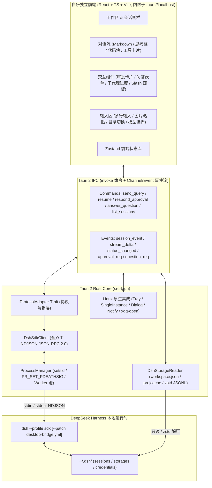

# DSH Linux 桌面端（dsh-desktop-linux）设计文档

> **版本**：v2.0（独立客户端 + 底层协议直连架构）  
> **日期**：2026-11-20  
> **仓库路径**：`/home/ctrlsea/code/dsh-desktop-linux`  
> **目标平台**：Ubuntu 26.04 LTS (x86_64, GNOME Wayland / X11)  
> **适配运行时**：DeepSeek Harness (`@deepseek-ai/dsh` ≥ `0.2.2-rc.5`)

---

## 1. 背景与架构定位

DeepSeek Harness（`dsh`）的官方桌面端为 macOS / Windows 的 Electron 应用，其通过私有 `window.dshDesktop` / `window.dshDesktopBoot` Preload 协议与 `dsh-web-frontend` 深度耦合；而 `dsh web` 则是面向浏览器的 HTTP 服务，带有 `launchToken` / `HttpOnly` Cookie 交换、浏览器信任围栏（browser-trust fence）及桌面协议副作用。

本项目采取**彻底脱离官方 Web/Electron 套壳**的路线：

- **不加载官方 `dsh-web-frontend`**，不依赖 `dsh web` HTTP 服务，不模拟官方 `window.dshDesktop` Electron 协议；
- **自研独立 Linux 桌面前端**（打包为纯静态资源内嵌于 Tauri 2，通过 `tauri://localhost` 运行）；
- **Rust 后端直接对接 `dsh` 底层开放协议**（`dsh --profile sdk` 的 stdio JSON-RPC 2.0 通道）并直读 `~/.dsh` 持久化存储，向上暴露干净的自有领域模型给前端 UI。

### 1.1 核心目标

1. **协议自主可控**：通过 Rust `ProtocolAdapter` 抽象层屏蔽 `dsh` 底层协议细节，彻底摆脱官方 Web/Electron 协议的鉴权限制、Origin 限制与 UI 耦合。
2. **轻量原生高性能**：Tauri 2 (Rust) + 系统 WebKitGTK 4.1 + 自研轻量前端，零 Chromium 冗余、零额外本地 HTTP 监听端口。
3. **100% 复用 DSH Agent 引擎与生态**：完整保留 `dsh` 的工具执行、沙箱、审批策略、MCP、Skills、Subagents、`schedule`、持久化格式，且与 `dsh tui` / `dsh web` 共享 `~/.dsh/sessions/` 历史会话。
4. **一等公民 Linux 桌面体验**：原生目录选择器、系统托盘、单实例锁、桌面通知（审批/长任务完成提醒）、Wayland + NVIDIA 渲染兼容、`.deb` 安装包。

---

## 2. 宿主机与 `dsh` 底层协议深度调研

### 2.1 宿主机与工具链实测

| 项目 | 实测状态 | 备注 |
| --- | --- | --- |
| 操作系统 | Ubuntu 26.04.1 LTS (resolute) | GNOME on Wayland |
| 图形硬件 | NVIDIA RTX 4060 Max-Q + AMD Phoenix1 iGPU | 双显卡 + Wayland，需处理 WebKitGTK DMA-BUF 兼容 |
| Rust / Tauri | `rustc 1.99.1` / `cargo 1.99.1` / `tauri-cli 2.12.6` | 已就绪 |
| 系统图形依赖 | `webkit2gtk-4.1` (2.52.6) / `gtk+-3.0` (3.24.52) / `ayatana-appindicator3-0.1` (0.5.94) | 开发头文件全部已就绪 |
| Node / dsh | Node `v26.13.0` / `pnpm 12.21` / `dsh 0.2.2-rc.5` | `/home/ctrlsea/.local/bin/dsh` |

### 2.2 `dsh` 底层协议选型对比

源码分析 `@deepseek-ai/dsh@0.2.2-rc.5` 内置的三种无界面/可编程入口：

| 协议入口 | 传输方式 | 工具与交互能力 | 适用定位 | 结论 |
| --- | --- | --- | --- | --- |
| `dsh --profile web` | HTTP + Cookie + WS | 完整，但强绑定官方 Web 前端与鉴权围栏 | 浏览器 / 套壳 | **放弃**（非本方案目标） |
| `dsh --profile acp` | stdio NDJSON (ACP v1) | 仅标准自动化子集：无 `ask_user_question`、无 `present` 卡片、无历史回放、无终端/计划语义 | 自动化测试 / 外部子代理 | **可选扩展**（第二适配器） |
| **`dsh --profile sdk`** | **stdio NDJSON (JSON-RPC 2.0)** | **完整原生桌面工具集**：内置 `present`、`tool-ask-user`、`tool-schedule`、`plugin_manager`、`subagent`、`approval/request` 双向回调、完整 `SessionEvent` 事件流、图片 Base64 传入、Slash 命令（`/compact` `/goal` 等） | **原生客户端 / SDK 宿主** | **主选协议** |

### 2.3 `dsh --profile sdk`  wire 协议完整矩阵

基于 `@deepseek-ai/dsh-sdk-protocol/src/types.ts` 与 `@deepseek-ai/dsh-sdk-jsonrpc-server/src/server.ts` 源码实测：

- **帧格式**：UTF-8 换行分隔 JSON-RPC 2.0（NDJSON），`stdout` 独占协议帧，`stderr` 输出诊断日志；`stdin` EOF 触发优雅关闭。

#### (1) Client → Server 请求（`HarnessSdkRequestMap`）
| 方法 | 参数要点 | 返回 | 说明 |
| --- | --- | --- | --- |
| `initialize` | `{ cwd, provider, model, reasoningEffort?, maxTokens?, approvalRequests: true, capabilities: { userQuestions: true } }` | `{ serverInfo }` | 进程级握手，开启审批回调与用户问答回调 |
| `session/query` | `{ sessionId, contentBlocks }` | 队列回执或命令结果 | **首选提交入口**：同时支持普通文本/Base64 图片消息与 Slash 命令（`/compact`, `/goal` 等） |
| `session/prompt` | `{ sessionId, contentBlocks }` | `{ messageId }` | 纯用户消息入队，未知 `sessionId` 自动懒创建会话 |
| `session/resume` | `{ sessionId }` | `{}` | 恢复 `~/.dsh/sessions/` 中的持久化会话 |
| `session/wait` | `{ sessionId }` | `{}` | 等待会话及其托管子代理全部进入空闲态 |
| `session/working-directory/get` | `{ sessionId }` | `{ cwd }` | 获取会话当前有效工作目录 |
| `session/working-directory/set` | `{ sessionId, path }` | `{ cwd }` | 切换会话有效工作目录 |
| `shutdown` | `undefined` | `{}` | 优雅释放根 Cordis 树、落盘并退出码 0 |

#### (2) Server → Client 双向交互请求（由桌面端弹窗/卡片应答）
| 方法 | 参数要点 | 客户端应答 | 说明 |
| --- | --- | --- | --- |
| `approval/request` | `{ sessionId, toolName, callId?, reason? }` | `{ outcome: 'allowed-once' \| 'rejected' \| 'cancelled' }` | 工具执行审批（含子代理操作），断连自动 fail-closed |
| `user-question/ask` | `{ requestId, sessionId, questions: AskUserQuestionItem[] }` | `AskUserQuestionAnswer \| { cancelled: true }` | Agent 调用 `ask_user_question` 时的结构化表单问答 |

#### (3) Server → Client 实时通知（`HarnessSdkNotificationMap`）
- `session.event` (`{ sessionId, event: SessionEvent }`)：每条持久化事件实时推送（`turn/start`、`assistant/message`、`tool/result`、`step/end`、`turn/end` 等）
- `session.status` (`{ sessionId, status: 'idle' | 'running' }`)：Agent 运行态切换
- `session.query.completed` (`{ sessionId, commandId, finalResponse, finishReason }`)：命令类 query 完成
- `user-question.cancelled` (`{ requestId, sessionId }`)：问题超时或被取消时清理前端卡片
- `subagent.started` / `subagent.finished`：进程内子代理启动与结束状态

### 2.4 `~/.dsh` 本地持久化结构实测

通过探查本机 `~/.dsh`，历史数据完全透明可读：

1. **工作区索引**：`~/.dsh/storages/workspace.json`
   - 包含 `workspaces` 表（`path`、`title`、`sessionIds`）、`pinnedSessionIds`、`archivedSessionIds`、`defaultWorkspaceId`。
2. **会话投影缓存**：`~/.dsh/storages/session_projcache/sessions/<sessionId>.json`
   - 纯 JSON 文件，包含 `identity`（`createdAt`、`cwd`、`formatVersion`）与 `rows`（`turnBoundary`、`sandboxMode`、`approvalState`、标题/摘要等），适合**毫秒级渲染侧栏会话列表**。
3. **完整会话事件流**：`~/.dsh/sessions/<encoded-cwd>/<sessionId>/session.v4.jsonl.zstd`
   - Zstandard 压缩的 JSONL 事件日志，与 `session.event` 通知使用完全相同的 `SessionEvent` schema；Rust 通过 `zstd` crate 直接流式解压即可还原任意历史会话的完整聊天记录（含 `dsh tui` / `dsh web` 创建的会话）。

### 2.5 `dsh sdk` 原生协议的 4 个能力缺口及双层解法

调研发现，原生 `dsh --profile sdk`（v0.2.2-rc.5）为保持 SDK 精简，尚未直接提供以下 4 项桌面端常用能力：

| 缺口 | 影响 | Layer 1 解法（零插件，纯 Rust 开箱即用） | Layer 2 解法（自有 Cordis `--patch` 扩展插件） |
| --- | --- | --- | --- |
| 1. 会话列表与历史回放 | `session/resume` 不回放历史消息 | Rust 直读 `workspace.json` + `session_projcache/*.json` + `zstd` 解压 `session.v4.jsonl.zstd` | 同 Layer 1（Rust 直读最快且零额外进程开销） |
| 2. 逐 Token 流式打字机（Delta） | `session.event` 仅推送 committed 事件 | 先按块/按步（thinking / tool_use / text）实时刷新渲染，保证可用 | 通过 `dsh --profile sdk --patch desktop-bridge.yml` 注入 ~200 行自有 Cordis 插件，订阅底层 LLM stream 推送 `desktop/stream.delta` |
| 3. 单轮中途中断（Abort） | 协议无 `session/cancel` 方法 | 紧急中断可通过 `shutdown` 重启 Worker（仅影响单会话 Worker） | 自有 Cordis 插件暴露 `desktop/session.abort`，直接调用 Agent 的 `AbortController` 优雅中断 |
| 4. 模型目录查询与热切换 | `initialize` 固定默认 `provider`/`model` | 读取配置文件与 `~/.dsh` 配置；切换模型时重建/复用对应配置的 Worker | 自有 Cordis 插件暴露 `desktop/models.list` 与 `desktop/session.setModel`，实时读取 live LLM catalog 并热切模型 |

> **设计亮点**：Layer 1 让项目在 **零上游侵入** 的情况下迅速跑通完整桌面闭环；Layer 2 利用 `dsh` 官方原生支持的 `--patch` 插件机制补齐流式 delta、实时中断与模型热切，且**全程完全绕过官方 Web/Electron 协议**。

---

## 3. 总体架构设计



### 3.1 核心解耦原则：`ProtocolAdapter` 抽象层

前端**绝不直接解析** `dsh` 原始 JSON-RPC 报文。Rust 层通过 `ProtocolAdapter` trait 将底层事件转换为统一的桌面端领域事件（`DesktopEvent`），带来三大收益：
1. 即使 `dsh` 升级调整内部事件字段，只需修改 Rust 适配层；
2. 未来可平滑切换或并存 `dsh sdk`、`dsh sdk + desktop-bridge patch`、`dsh acp` 等多种后端；
3. 前端状态管理与组件渲染逻辑高度纯净、易于测试。

---

## 4. 核心模块详细设计

### 4.1 全双工 JSON-RPC 客户端与进程托管（`src-tauri/src/protocol/`）

#### (1) 全双工通信模型
`dsh --profile sdk` 是**双向 RPC**（客户端可发 `session/query`，服务端在工具执行期间也会主动发起 `approval/request` 和 `user-question/ask` 等待客户端响应）。Rust 端采用双协程架构：
- **Writer Task**：持有子进程 `stdin`，通过 `mpsc::Sender<JsonRpcMessage>` 串行写入 JSON-RPC 请求与对服务端请求的响应（带 `\n` 刷新）。
- **Reader Task**：使用 `BufReader::lines()` 逐行读取子进程 `stdout`：
  - 若含 `id` 且含 `result`/`error`：路由至 `pending_client_requests: HashMap<RequestId, oneshot::Sender<_>>`；
  - 若含 `id` 且含 `method`（服务端反向请求：`approval/request`、`user-question/ask`）：生成内部审批/问答 ID，缓存 JSON-RPC `id` 到 `pending_server_requests`，通过 Tauri Event 推送给前端 UI；用户点击后前端调用 `invoke("respond_approval", ...)`，Rust 构造 JSON-RPC Response 经 Writer Task 回写；
  - 若无 `id`（通知：`session.event`、`session.status`、`subagent.*`、`desktop/stream.delta`）：转换为领域事件实时推送给前端。
- **Stderr Task**：异步读取 `stderr` 写入滚动日志 `~/.local/share/dsh-desktop/logs/dsh-sdk.log`，供故障排查。

#### (2) `dsh` 可执行文件探测与进程组防孤儿
- **探测顺序**：`config.toml` 指定路径 → `DSH_DESKTOP_BIN` → `PATH` → 回退扫描 `~/.local/bin/dsh`、`~/.npm-global/bin/dsh`（同时将 `~/.local/bin` 补入子进程 `PATH`，避免从 GNOME `.desktop` 启动找不到 `node`/`dsh`）。
- **Linux 进程组隔离**：
  - `pre_exec` 调用 `libc::setsid()` + `libc::prctl(libc::PR_SET_PDEATHSIG, libc::SIGTERM)`；
  - 正常退出先发 JSON-RPC `shutdown` 请求并等待 3 秒；超时则向 `-pgid` 发送 `SIGTERM`，再等待 2 秒后 `SIGKILL` 兜底，确保不残留 `node` 或工具子进程。

#### (3) Worker 生命周期与多会话并发
- `dsh --profile sdk` 单进程原生支持多会话并发（按 `sessionId` 隔离 Agent 实例与 `working-directory`）；
- 默认启动一个常驻 SDK Worker 承接当前主模型的全部会话；
- 当用户在 Layer 1 下需要切换不同 `provider`/`model` 时，可按 `(provider, model, reasoningEffort)` 键值按需派生或复用轻量 Worker；升级至 Layer 2（`desktop-bridge.yml`）后单 Worker 内即可热切模型。

---

### 4.2 本地存储直读引擎（`src-tauri/src/storage/`）

1. **工作区与会话列表（`list_workspaces_and_sessions`）**：
   - 解析 `~/.dsh/storages/workspace.json` 获取工作区列表、置顶/归档标记；
   - 扫描 `~/.dsh/storages/session_projcache/sessions/*.json` 获取会话元数据（创建时间、`cwd`、最后活跃时间、标题、审批模式）；
   - 按 `updatedAt` 倒序聚合返回给侧栏，冷启动百条会话耗时 < 10ms。
2. **历史会话回放（`load_session_history(session_id)`）**：
   - 根据 `cwd` 编码规则或目录扫描定位 `session.v4.jsonl.zstd`；
   - 使用 Rust `zstd::stream::Decoder` 流式解压并逐行反序列化为 `SessionEvent`；
   - 与实时流复用同一套投影函数，产出与实时消息完全一致的 `UiMessage[]` 结构。
3. **并发安全**：只读访问 `~/.dsh/sessions/`，不与 `dsh` 争抢 `session.lock`，避免破坏原生态锁机制。

---

### 4.3 Layer 2：自有 Cordis 扩展插件（`bridge-plugin/`，Phase 3 引入）

为补齐 `dsh sdk` 原生协议的 3 项交互体验缺口，编写一个极简（~200 行 TypeScript）的无依赖 Cordis 插件包，通过 `dsh --profile sdk --patch ~/.config/dsh-desktop/desktop-bridge.yml` 挂载：

- **订阅底层 LLM 流事件** → 通过同一 stdout JSON-RPC 推送 `desktop/stream.delta`（`{ sessionId, turnId, blockType: 'thinking' | 'text' | 'tool_input', delta }`），实现丝滑打字机流式输出；
- **注册 `desktop/session.abort`** → 触发对应 `sessionId` 正在运行 Agent 的中止信号；
- **注册 `desktop/models.list` 与 `desktop/session.setModel`** → 查询已配置 Provider 的实时可用模型列表，并支持会话内切换模型与 `reasoning_effort`。
- **降级兼容**：Rust 客户端在 `initialize` 后探测扩展能力，若用户未启用插件或升级导致插件暂不可用，自动平滑回退到 Layer 1 标准 `dsh sdk` 协议，不影响核心对话功能。

---

### 4.4 自研独立前端设计（`ui/`）

#### (1) 前端技术栈
- **构建与框架**：Vite 6 + React 19 + TypeScript + Tailwind CSS v4 + Zustand
- **内容渲染**：`react-markdown` + `remark-gfm` + `rehype-katex`（数学公式）+ `shiki`（语法高亮）
- **交互增强**：虚拟滚动（长会话性能优化）、Diff 视图（文件编辑类工具调用展示）
- **零外部后端依赖**：`pnpm build` 产出静态目录 `ui/dist`，由 Tauri 直接嵌入二进制并通过 `tauri://localhost` 提供服务。

#### (2) 核心界面布局（三栏工作台）
1. **左侧栏（Workspace & Sessions）**：
   - 工作区切换（原生目录选择器添加新工作区）、按工作区折叠会话列表、搜索过滤、置顶/归档、新建会话按钮；
   - 底部状态指示灯（SDK Worker 状态 / 当前模型 / 设置入口）。
2. **主对话区（Conversation Stream + Composer）**：
   - **消息流**：用户消息（文本 + 图片缩略图）、可折叠的思考过程（Thinking）、Markdown 正文、结构化工具调用卡片（折叠显示命令/参数/耗时/退出码，展开看输出与 Diff）；
   - **内嵌交互卡片**：
     - **审批卡片（`approval/request`）**：醒目展示工具名、调用原因与参数，提供「允许本次」「拒绝」「取消」按钮，支持快捷键确认；
     - **问答卡片（`user-question/ask`）**：动态渲染单选/多选/文本输入表单，提交后立即回传给 Agent；
   - **输入区（Composer）**：多行自增输入框、粘贴/拖拽图片（编码为 `SdkEncodedImageBlock`）、`/` 触发 Slash 命令补全（`/compact`、`/goal` 等）、当前工作目录快捷切换、模型/推理强度选择器、发送/停止按钮。
3. **右侧可折叠面板（Inspector）**：
   - **子代理树（Subagents）**：实时展示 `subagent.started` / `subagent.finished` 状态与最终摘要；
   - **会话元数据**：当前 `cwd`、Token 统计、审批策略、运行日志查看。

---

### 4.5 Linux 原生桌面集成（`src-tauri/src/native/`）

1. **Wayland + NVIDIA WebKitGTK 兼容**：
   - 在 `main.rs` 初始化 GTK 前，根据配置 `graphics.disable_dmabuf`（默认 `"auto"`：检测到 Wayland + NVIDIA GPU 时自动生效）设置 `WEBKIT_DISABLE_DMABUF_RENDERER=1`；
   - 提供 `--disable-dmabuf` / `--enable-dmabuf` / `--software-rendering` CLI 开关；
   - 保持 `GTK_IM_MODULE` / `XMODIFIERS` 透传，确保 IBus / Fcitx5 中文输入法正常。
2. **单实例锁（`tauri-plugin-single-instance`）**：二次启动自动唤起并置顶已有主窗口，支持传参打开指定目录工作区（如 `dsh-desktop /path/to/repo`）。
3. **系统托盘（`tray-icon` + `libayatana-appindicator3`）**：
   - 菜单：显示/隐藏窗口、新建会话、重启 SDK Worker、查看日志目录、退出；
   - 默认开启「关闭窗口最小化到托盘」，保证长耗时 Agent 与 `schedule` 任务在后台持续执行。
4. **桌面通知（`tauri-plugin-notification`）**：
   - 当窗口处于后台或隐藏状态时，收到 `approval/request`、`user-question/ask` 或长任务 `session.status -> idle` 自动弹出系统通知，点击通知直接聚焦对应会话。
5. **原生文件对话框与外链**：
   - 使用 `tauri-plugin-dialog` 选择工作区目录与上传图片附件；
   - 拦截对话区外部链接，调用 `tauri-plugin-opener`（`xdg-open`）交由系统默认浏览器打开。
6. **XDG 规范路径**：
   - 配置：`~/.config/dsh-desktop/config.toml`（默认 provider/model、dsh 路径、窗口状态、主题、显卡兼容、是否启用 Layer 2 bridge）；
   - 日志：`~/.local/share/dsh-desktop/logs/`（滚动日志）。

---

## 5. 前后端 Tauri IPC 契约设计

### 5.1 Commands（前端 → Rust `invoke`）

| Command | 参数 | 返回 | 说明 |
| --- | --- | --- | --- |
| `get_app_state` | — | `AppStateSnapshot` | 获取配置、Worker 状态、当前默认模型与工作区 |
| `list_workspaces` | — | `WorkspaceSummary[]` | 直读 `workspace.json` + `session_projcache` |
| `load_session_history` | `{ sessionId }` | `UiSessionDetail` | 解压 `session.v4.jsonl.zstd` 返回完整历史消息 |
| `create_session` | `{ cwd, provider?, model? }` | `{ sessionId }` | 生成新会话 ID 并绑定工作目录 |
| `resume_session` | `{ sessionId }` | `{ cwd }` | 调用 `session/resume` 激活历史会话 |
| `send_query` | `{ sessionId, text, images? }` | `{ messageId? }` | 调用 `session/query` 发送消息或 Slash 命令 |
| `abort_session` | `{ sessionId }` | `void` | 中断当前生成（Layer 2 优雅中止 / Layer 1 兜底） |
| `respond_approval` | `{ requestId, outcome }` | `void` | 响应 `approval/request` |
| `respond_user_question` | `{ requestId, answer }` | `void` | 响应 `user-question/ask` |
| `set_working_directory` | `{ sessionId, path }` | `{ cwd }` | 切换会话 `cwd` |
| `pick_directory` | — | `string \| null` | 调用原生目录选择器 |
| `update_config` | `PartialConfig` | `AppConfig` | 更新并持久化 `config.toml` |

### 5.2 Events（Rust → 前端实时推送）

- `dsh://session-event`：标准化后的消息/工具/回合事件
- `dsh://stream-delta`：Layer 2 逐 Token 流式文本/思考增量
- `dsh://session-status`：`{ sessionId, status: 'idle' | 'running' }`
- `dsh://approval-request`：`{ requestId, sessionId, toolName, callId?, reason? }`
- `dsh://user-question`：`{ requestId, sessionId, questions }`
- `dsh://user-question-cancelled`：`{ requestId, sessionId }`
- `dsh://subagent-update`：子代理启动/完成状态
- `dsh://worker-status`：后端进程状态变化（`starting` / `ready` / `crashed` / `restarting`）

---

## 6. 仓库目录结构规划

```text
dsh-desktop-linux/
├── README.md
├── 设计文档.md
├── scripts/
│   └── build-deb.sh                 # 设置 .build-target / .build-tmp 并构建 .deb
├── bridge-plugin/                   # [Phase 3] 可选轻量 Cordis 扩展插件 (delta/abort/models)
│   ├── package.json
│   └── src/index.ts
├── ui/                              # 自研独立前端 (Vite + React + TS + Tailwind)
│   ├── package.json
│   ├── vite.config.ts
│   ├── index.html
│   └── src/
│       ├── main.tsx
│       ├── App.tsx
│       ├── types/domain.ts          # 与 Rust 对应的领域类型
│       ├── api/tauri.ts             # Tauri invoke / listen 封装
│       ├── store/useAppStore.ts     # Zustand 状态树
│       └── components/
│           ├── Sidebar.tsx          # 工作区与会话列表
│           ├── ChatStream.tsx       # 消息流、Markdown、思考链、工具卡片
│           ├── ApprovalCard.tsx     # 工具审批交互卡片
│           ├── QuestionCard.tsx     # ask_user_question 表单卡片
│           ├── SubagentPanel.tsx    # 子代理状态面板
│           ├── Composer.tsx         # 输入框、图片粘贴、Slash 命令
│           └── SettingsModal.tsx    # 模型/路径/托盘/渲染设置
└── src-tauri/
    ├── Cargo.toml
    ├── tauri.conf.json
    ├── capabilities/default.json
    ├── icons/
    └── src/
        ├── main.rs                  # 入口：Wayland/NVIDIA DMABUF 兼容处理 + 启动
        ├── lib.rs                   # Tauri Builder 装配
        ├── config.rs                # XDG config.toml 加载与保存
        ├── logging.rs               # tracing 滚动日志
        ├── domain.rs                # 标准化领域模型（前后端共享契约）
        ├── protocol/
        │   ├── mod.rs               # ProtocolAdapter trait 定义
        │   ├── jsonrpc.rs           # 全双工 NDJSON JSON-RPC 2.0 传输层
        │   ├── sdk_types.rs         # dsh-sdk-protocol Rust serde 类型
        │   └── sdk_adapter.rs       # dsh --profile sdk 进程组托管与协议适配
        ├── storage/
        │   ├── mod.rs               # ~/.dsh 只读引擎
        │   ├── workspace.rs         # workspace.json & session_projcache 解析
        │   └── transcript.rs        # zstd 解压 session.v4.jsonl.zstd 与消息投影
        ├── native/
        │   ├── tray.rs              # Ayatana 系统托盘
        │   ├── window.rs            # 窗口状态持久化、快捷键缩放、外链拦截
        │   └── notify.rs            # 后台审批/完成系统通知
        └── commands.rs              # 暴露给前端的 #[tauri::command]
```

### 核心 Rust 依赖选型

- `tauri = { version = "2", features = ["tray-icon"] }`
- `tauri-plugin-single-instance = "2"` / `tauri-plugin-dialog = "2"` / `tauri-plugin-opener = "2"` / `tauri-plugin-notification = "2"`
- `tokio = { version = "1", features = ["full"] }`
- `serde` / `serde_json` / `toml`
- `zstd`（直读 `session.v4.jsonl.zstd`）
- `uuid`（生成新 `sessionId` 与请求追踪 ID）
- `directories` / `tracing` / `tracing-subscriber` / `tracing-appender` / `libc`

---

## 7. 分阶段实施路线图与验收标准

### 阶段 0：基线与协议验证（0.5 天）
- 验证当前 `src-tauri` 骨架在 `.build-target` / `.build-tmp` 下编译与 Wayland + NVIDIA 窗口渲染；
- 用命令行/最小 Rust 测试程序对 `dsh --profile sdk` 跑通一次 `initialize` → `session/query` → 接收 `session.event` → `shutdown` 端到端握手。
- **验收**：确认 `dsh --profile sdk` 在本机凭据下正常响应且 stdout 帧格式纯净。

### 阶段 1：MVP 独立对话闭环（2~3 天）
- 实现 Rust `protocol/jsonrpc.rs` + `protocol/sdk_adapter.rs`（含进程组防孤儿）；
- 搭建 `ui/`（Vite + React + TS + Tailwind）最小对话界面；
- 跑通新建会话、发送文本/图片、渲染 Markdown + 思考过程 + 工具调用卡片、响应 `approval/request` 与 `user-question/ask` 卡片。
- **验收**：完全脱离 `dsh web` 与浏览器，在独立 Linux 桌面窗口中完成完整多轮 Agent 编码对话与工具审批。

### 阶段 2：历史会话直读与完整工作台（2~3 天）
- 实现 `storage/` 模块，直读 `workspace.json`、`session_projcache` 与 `zstd` 解压 `session.v4.jsonl.zstd`；
- 完成三栏工作台：工作区管理、历史会话列表与无缝 `session/resume`、Slash 命令补全、Subagent 面板、设置弹窗。
- **验收**：打开应用即可看到并无缝恢复此前在 `dsh tui` / `dsh web` 创建的所有历史会话，冷启动列表加载 < 50ms。

### 阶段 3：Cordis `--patch` 扩展桥接（2 天）
- 编写 `bridge-plugin/` 并通过 `--patch` 注入 `dsh --profile sdk`；
- 实现逐 Token 流式打字机（`desktop/stream.delta`）、实时停止生成（`desktop/session.abort`）、动态模型目录与会话内热切模型；
- 保留自动降级机制（无插件时平滑退回 Layer 1）。
- **验收**：回复过程逐字流畅输出，点击「停止」1 秒内中断生成，可在 UI 内直接切换可用模型。

### 阶段 4：Linux 原生桌面体验与打包（1~2 天）
- 集成单实例锁、Ayatana 系统托盘（关闭最小化到托盘）、窗口几何持久化、审批/完成桌面通知、外链 `xdg-open`；
- 完成 `.deb` 打包脚本与 GNOME 应用菜单 / Dock 图标验证。
- **验收**：安装 `.deb` 后可从应用菜单启动，退至托盘后 Agent 任务持续运行，需要审批时弹出桌面通知，彻底退出后无任何残留进程。

---

## 8. 风险与缓解措施

| 风险点 | 影响 | 缓解措施 |
| --- | --- | --- |
| **第三方 `dsh` 插件向 `stdout` 打印杂讯**（如本机 `dsh-purge-community` 提示） | 破坏 NDJSON 帧解析，导致 JSON-RPC 断连 | Reader Task 对非 `{` 开头或 JSON 解析失败的行做容错降级：归入诊断日志而非直接崩溃断连 |
| **Wayland + NVIDIA 下 WebKitGTK 渲染异常** | 窗口黑屏或闪退 | 启动前自动探测并设置 `WEBKIT_DISABLE_DMABUF_RENDERER=1`，保留配置与 CLI 开关 |
| **上游 `dsh` 升级调整 `session.v4.jsonl.zstd` 格式** | 历史会话回放解析异常 | 对未知 `SessionEvent.type` 做宽容反序列化（`#[serde(other)]` / `serde_json::Value` 兜底展示） |
| **工具/子代理进程残留** | 退出桌面端后后台泄漏进程 | 独立进程组 `setsid` + `PR_SET_PDEATHSIG` + `shutdown` → `SIGTERM` → `SIGKILL` 三段式退出 |
| **从 `.desktop` 启动找不到 `dsh`/`node`** | 启动失败 | 启动器自动补全 `~/.local/bin` 等常见路径，并在设置页支持手动指定 `dsh` 绝对路径 |
